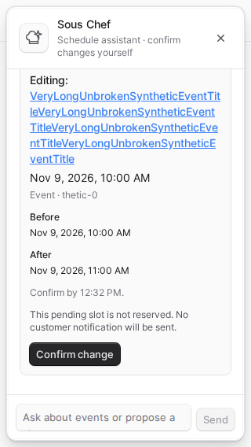
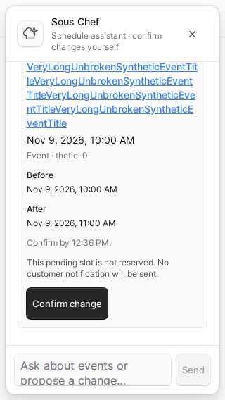
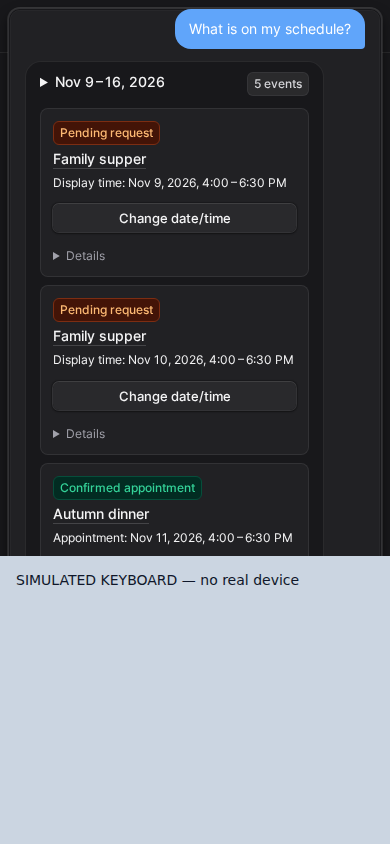
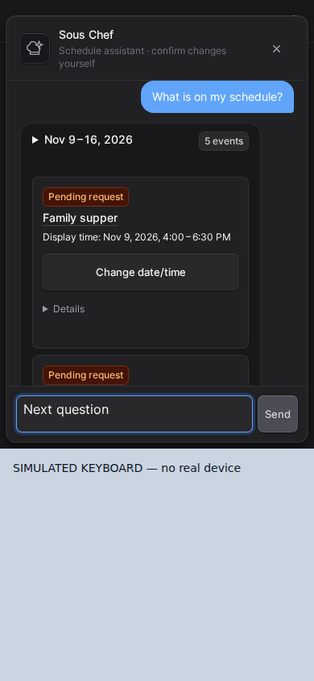

# BTS-22: mobile chat layout and usability

Implemented on a new `feat/sous-chef-mobile-chat-v1` branch based on `a3a96e4d9fa89a1cce83ad9259f8c4a667085589` (current main, including #39). No old BTS-21 branch was reused. Origin was fetched and open PRs checked before work and before handoff; no competing Sous Chef PR was open.

Task: [BTS-22](https://arborthreads.com/threads/thr_be177a01-4b82-4586-9288-926e1e81f73b/sous-chef-mobile-chat-layout-and-usability). [Requested source review](https://arborthreads.com/threads/thr_be177a01-4b82-4586-9288-926e1e81f73b#c-con_9a03e2885399cbe629e661fd1ea48791d5d1415c736a3e17f845d3a00c93e32f): Arbor redirected to sign-in and no Arbor connector was available. The owner's implementation brief supplied the scope; the linked review was **not read**.

## Reproduction and changes

Production-built Medusa Admin, Chromium, intercepted synthetic API responses only. No backend server, paid model, database, customer data, notification, or production-write setting was used. Both themes were exercised at 320×568, 375×667, 390×844, 430×932, 667×320 landscape, and 1440×900 desktop.

1. Open Sous Chef, request the week, select Change date/time, enter 11:00, scroll to Confirm, then send a new question. The original `scrollIntoView({block:'start'})` scrolls the overflow-hidden outer dialog as well as the conversation. At 390px, Close moves from y=34 to y=-45 despite the panel remaining at y=8. This failure occurs before keyboard simulation. The localized `scrollChatTarget` helper moves only the log; programmatic composer/editor focus uses `preventScroll`.
2. At 320px, Close is 28×28px, Send is 48×28px, and the composer uses 13px text. Mobile/short-landscape controls now have 44px minimum targets and inputs use 16px text. Existing 320px date/time stacking and long-title wrapping already worked and were preserved.

An additional **overlay-keyboard DOM simulation** holds the layout viewport at 390×844 but changes `visualViewport.height` to 544 and `offsetTop` to 12. The original 100dvh panel remains 828px tall, putting Send under the simulated occlusion. The open dialog now subscribes to its visual viewport and sets panel-local height/top CSS variables. The subscription waits for Radix portal mounting, cleans up on close/unmount, and ignores pinch-zoom changes. Only mobile and short-landscape CSS consumes these variables; unsupported browsers retain the dvh fallback. No global scroll lock, viewport meta change, dependency, or global listener was added.

The existing log overscroll containment remains. Browser checks add an inert tall spacer to the actual Admin main element and verify wheel scrolling at the log boundary leaves underlying scrollers stationary. New-answer scrolling also keeps Close within the panel. Read-only preview and unused-Confirm invalidation are exercised in every matrix case; Send/Close pass browser hit-testing in the simulated keyboard viewport.

## Before/after evidence — Chromium emulation, not phones

[Baseline measurements](mobile-evidence/before/result.json) and [final measurements](mobile-evidence/after/result.json) retain viewport, control, scroll-width and font measurements. Baseline evidence predates the additional after-turn and tall-background measurements in the final harness; it contains the same workflow and overlay simulation. The baseline keyboard screenshot includes the independently reproduced header-scroll failure.

| Scenario | Before | After |
| --- | --- | --- |
| 320px light, long preview |  |  |
| 390px dark, simulated keyboard |  |  |

[Representative desktop screenshot](mobile-evidence/after/preview-desktop-dark.png). Desktop panel remains 490×760 at 1440×900. The after keyboard screenshot has a filled next-question draft to demonstrate enabled Send hit-testing.

## Executed validation

Node 26.13.1, existing repository dependency installation (linked locally; no manifest/lockfile changes). Commands run from repo root unless stated otherwise:

- `yarn workspace medusa build` — passed before and after; production Admin assets tested.
- `yarn workspace medusa typecheck` — passed after final runtime changes.
- `yarn workspace medusa test:unit --runTestsByPath src/lib/__tests__/chef-chat-ui.unit.spec.ts src/lib/__tests__/schedule-edit-state.unit.spec.ts src/lib/__tests__/schedule-edit-ui.unit.spec.ts` — **3 suites, 114 tests passed**. Includes new viewport lifecycle/pinch-zoom regression; existing Enter/Shift+Enter/IME composition, exact-event targeting, unused-preview invalidation, manual Confirm and attempted-write recovery. [Log](mobile-evidence/unit.log).
- `node docs/chef-ai/mobile-chat-acceptance.cjs` — **12 viewport/theme cases passed**, no page errors or unexpected routes. Long preview, 320px stacking, input size, panel/control bounds, scroll containment, unused Confirm removal, and simulated keyboard hit-testing. Set `MOBILE_EVIDENCE_DIR` for output; `MOBILE_BASELINE=1` captures original defects without asserting their fixes.
- `node docs/chef-ai/pending-schedule-ui-acceptance.cjs` — passed existing built-Admin safety regression, **31 synthetic previews, 5 synthetic confirms, 2 synthetic recoveries**, no page errors or unexpected routes. Includes 202/409 and recovery outcomes. All requests are intercepted fixtures, not actual writes. [Log](mobile-evidence/schedule-browser.log).
- `node docs/chef-ai/typing-indicator-acceptance.cjs` — passed greeting/help pacing and mobile reduced-motion dots. [Log](mobile-evidence/typing-browser.log).
- `git diff --check` — passed.

For browser commands on this host:

```sh
export LD_LIBRARY_PATH=/tmp/bts-browser-libs/root/usr/lib/x86_64-linux-gnu
export NODE_PATH=/home/openclaw/projects/bts/node_modules
export PATH=/tmp/private-chef-node26-tools/node-v26.13.1-linux-x64/bin:$PATH
MOBILE_EVIDENCE_DIR=/tmp/bts22-mobile node docs/chef-ai/mobile-chat-acceptance.cjs
```

T3 native preview failed twice with missing host libraries; these existing unpacked libraries and Playwright/Chromium provided the fallback. No host packages were installed.

## Limits and review handoff

No real iOS/Android device was accessible. The keyboard test replaces `visualViewport` with a deterministic EventTarget and draws a labeled occlusion; it does **not** invoke a native OS keyboard. Real Safari keyboard animation/panning, predictive bars, native date/time pickers, nonzero hardware safe-area insets, pinch zoom, touch momentum and iOS text zoom remain device-validation gaps. 16px inputs address the usual zoom trigger but are not real-device proof. IME behavior was tested with synthetic composition events, not a device keyboard.

Runtime changes are confined to chat CSS, viewport/focus/scroll presentation. Schedule state/transport, immutable IDs, preview/Confirm/recovery authorization, Medusa modules/workflows, provider prompts, menu/availability, and #39 timing/dots are unchanged. No integration backend suites or paid evaluations were needed. Request focused Bumblesous review of scroll boundaries, viewport lifecycle, short landscape, device gaps and preserved safety behavior. The PR must remain open/unmerged; review is requested, not claimed complete.
